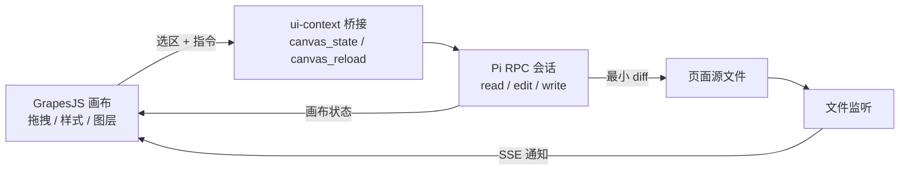

# Pi Canvas · 选中即改的 HTML 编辑器

把 **GrapesJS 可视化画布** 和 **Pi Agent** 接在一起：在页面上选中任意元素，用一句自然语言描述修改，Pi 读懂该元素的选择器 / DOM / 样式上下文，直接改写磁盘上的源文件，画布通过 SSE 自动刷新。

它不试图重造一个编辑器，而是给 Pi 装上「眼睛」和「手脚」：



## 快速开始

```bash
npm install
cp .env.example .env     # 可选，默认即可跑
npm start                # http://127.0.0.1:8787
```

前置条件：

- Node.js ≥ 20.6
- `pi` 在 PATH 中，并且已配置好模型凭据（`pi auth` / `~/.pi/agent/settings.json`）

启动后右上角会显示 `Pi 就绪`。如果没有，点「启动 Pi」查看原因，或打开 `PI_DEBUG=1` 查看 stderr。

## 核心交互：选中 → 描述 → 改写 → 刷新

1. **选中**：在画布上点击任意元素，元素旁会出现浮动工具条。
2. **描述**：点「✏️ 修改」后输入 `标题更大一点，加渐变文字`，或直接在右侧对话框输入；选区上下文会自动附加。
3. **改写**：前端把结构化上下文交给服务端，服务端组装成 `<ui-context>` 块发给 Pi。
   Pi 用 `canvas_state` / `read` 定位，用 `edit` 做最小 diff。
4. **刷新**：服务端监听 `site/` 目录，检测到文件变化后通过 SSE 通知浏览器，
   画布在保留滚动位置与选中元素的情况下重新载入。

发送前如果画布有未保存的改动，会先自动保存，保证 Pi 看到的是最新版本。

### 结构化上下文长什么样

```xml
<ui-context file="index.html" selector="section#hero > h1.title">
tag: h1
classes: title
component-path: body > section#hero > h1.title
text: "把想法说出来，"
computed-style: font-size: 62px; color: rgb(244, 245, 247); ...
outer-html:
```html
<h1 class="title">把想法说出来，<br><em>页面就已经在那里了</em></h1>
```
related-css:
```css
h1 { margin: 26px auto 20px; }
.hero h1 em { background: linear-gradient(...); }
```
</ui-context>

修改需求：
标题再大一点，并且第二行改成青蓝渐变
```

系统提示里同时写入了「编辑纪律」：只改选中元素、保留 id/class 锚点、优先 `edit` 最小 diff、不要整体重排文件。

## Pi 扩展：`extensions/canvas-bridge.ts`

扩展给 Pi 增加了两个工具，通过本地 HTTP（带令牌）连接编辑器：

| 工具 | 作用 |
| --- | --- |
| `canvas_state` | 读取当前页面、用户选中的元素（selector / outerHTML / 计算样式）、页面列表 |
| `canvas_reload` | 强制所有打开的画布重新从磁盘加载（可指定文件与刷新后重选的 selector） |

扩展本身**不碰文件**，文件读写仍然由 Pi 的 `read` / `edit` / `write` 完成，职责分离。
服务端启动 Pi 时通过 `PI_CANVAS_URL` 与 `PI_CANVAS_TOKEN` 注入地址和令牌。

启动参数（见 `server/prompt.js#buildPiArgs`）：

```
pi --mode rpc --no-session --no-extensions --no-mcp --no-skills --no-prompt-templates \
   --extension extensions/canvas-bridge.ts \
   --append-system-prompt "<编辑纪律>" \
   --tools read,edit,write,bash,canvas_state,canvas_reload
```

## 打开 URL

顶栏的「打开 URL」可以把外部页面抓取为一个新的本地页面再编辑：

- 支持 `http/https`，跟随重定向，20s 超时，最大 6 MB
- 移除 `<script>`、CSP meta、SRI（避免远端脚本接管画布）
- 把相对的 `href/src/srcset/url()` 改写成绝对地址，图片与字体仍能显示
- 文件名由域名与路径生成，例如 `https://example.com/pricing` → `example-com-pricing.html`
- 导入后自动打开该页面，可以继续用「选中即改」修改

「↗」按钮会在新标签页打开 `/preview/<page>`，与磁盘上的文件完全一致，方便分享或调试。

## 其他能力

- **区块库**：左侧拖拽 hero / 特性卡片 / CTA / 标题 / 按钮 / 卡片等区块
- **样式与属性**：右侧「样式 / 属性」面板是 GrapesJS 原生的 Style Manager 与 Traits
- **设备预览**：桌面 / 平板 / 手机三档宽度
- **预览与导出**：预览盖层与导出的 HTML 使用同一份 `mergeDocument` 输出
- **Mermaid 架构图**：左侧「图表 → Mermaid 架构图」插入，画布实时渲染成 SVG；
  选中后点浮层上的「源码」可直接改，Pi 也能改源文件里的 `<pre class="mermaid">`。
  保存 / 导出会自动注入 Mermaid 运行时，应用内预览使用本地 `/vendor/mermaid`，离线可用
- **历史版本**：每次让 Pi 动手前自动快照；恢复前也会再存一份，随时回退
- **保存即可读的源码**：CSS 由自定义解析器写入 GrapesJS（保留 `var()` 与简写），保存时排版成多行、清理临时 id
- **会话管理**：`新会话` 重置上下文；`停止` 中断当前运行；忙碌时继续发送会作为 steer 插入当前任务

## 目录结构

```
server/
  index.js        Express：SSE、页面读写、历史、URL 导入、Pi 生命周期
  pi-rpc.js       最小 Pi RPC 客户端（严格 JSONL，按 LF 切分）
  prompt.js       系统提示、<ui-context> 组装、Pi 启动参数
  workspace.js    页面读写、历史快照、恢复
  importer.js     URL 抓取与资源绝对化
  templates.js    初始页面模板
extensions/
  canvas-bridge.ts  Pi 扩展：canvas_state / canvas_reload
web/
  index.html
  styles.css
  src/app.js      交互编排（选区、对话、保存、历史、URL 导入）
  src/editor.js   GrapesJS 初始化、区块、画布载入
  src/context.js  从选区提取结构化上下文
  src/chat.js     对话与工具卡片渲染
  src/css.js      CSS 解析 / 规则写入 / 多行排版
  src/mermaid.js  画布内的 Mermaid 运行时注入与渲染
  src/doc.js      HTML 文档 ↔ 画布模型（纯函数，可单测）
  src/markdown.js 轻量 Markdown 渲染
  src/api.js      请求与 SSE 封装
site/             被编辑的页面（Pi 的工作目录）
data/history/     自动快照（git 忽略）
test/             node:test 单测
```

## 与原始方案的对应关系

| 原方案 | 本项目 |
| --- | --- |
| `pi-ui-bridge` 的「选中即改」 | ✅ 原生实现：GrapesJS 选区 → `<ui-context>` → Pi RPC → 文件监听刷新 |
| `pi-chrome-use` 的实时 DOM 操控 | 🚧 部分：URL 导入 + 预览；未接入 CDP |
| `pi-agent-xy` 的截图标注 | 🚧 未实现（可作为下一步：用 `canvas_state` + 截图工具扩展） |
| `pi-render` / `pi-artifacts` 的预览闭环 | ✅ 预览盖层 + SSE 实时重载 + 导出单文件 |
| GrapesJS 画布 + 桥接 + 执行 + 状态 | ✅ 四层均已落地 |

## 测试

```bash
npm test        # 文档转换与 prompt 组装的单测
```

## 说明与边界

- 服务默认只监听 `127.0.0.1`；URL 导入接口具备 SSRF 能力，不要直接暴露到公网。
- Pi 以 `--no-session` 运行，对话记录由服务端内存维护（刷新页面仍在，重启服务清空）。
- 画布中的远端样式表是从原站加载的；离线环境下页面骨架仍可编辑，只是外部字体/图片可能缺失。
- 页面约定为「完整 HTML 文档 + 内联 `<style>`」，页面里的脚本不会在画布中执行。
- Mermaid 图表在文件里保存为 `<pre class="mermaid">源码</pre>`；保存时会转义 `>` / `<` / `&`，
  浏览器解析后仍是原始源码，导出页面可直接独立打开（运行时来自 CDN）。
- GrapesJS 自带的 `setStyle(css)` 会丢掉 `background: var(--bg)` 这类声明，所以这里改为自己解析 CSS
  （`web/src/css.js`）后用 `Css.setRule()` 写入；`@font-face`、`@keyframes` 等暂不参与可视化编辑，但会原样保留。
